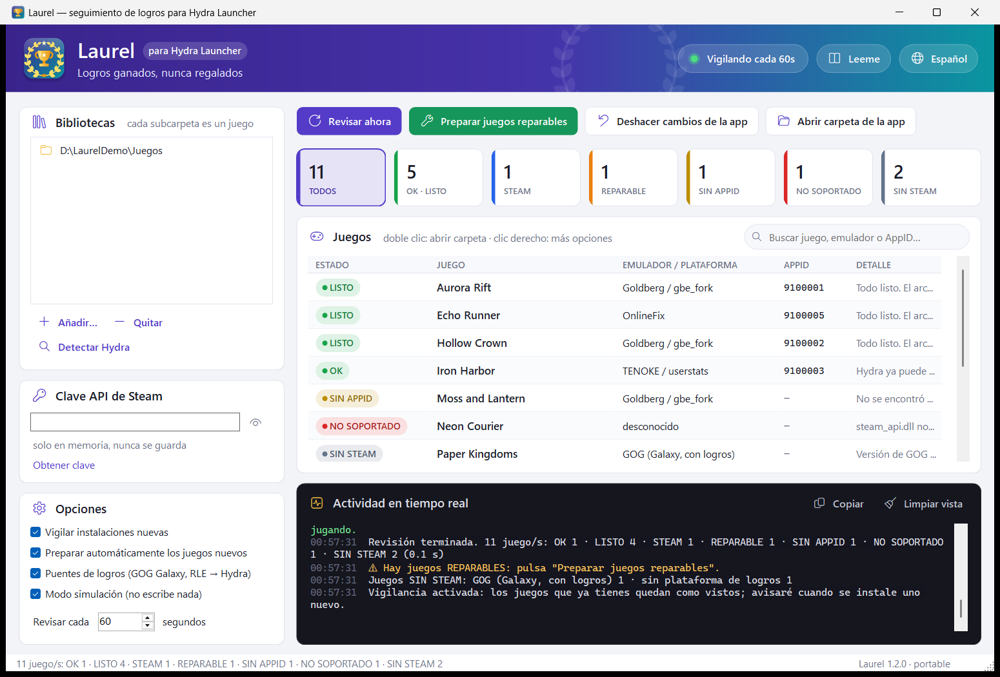

<p align="center"></p>

<h1 align="center">Laurel</h1>

<p align="center"><em>Logros ganados, nunca regalados · Achievements earned, never handed out</em></p>

<p align="center"></p>

**ES** — Laurel prepara tus juegos para que **Hydra Launcher registre los logros cuando los consigues jugando**. Detecta el emulador de cada juego, crea los archivos que faltan con la lista oficial de Steam, vigila las instalaciones nuevas y copia a Hydra los logros que ya conseguiste en GOG Galaxy o RLE. **Nunca desbloquea logros por su cuenta**, nunca sobrescribe tus archivos y todo lo que hace se puede deshacer.

**EN** — Laurel prepares your games so that **Hydra Launcher records achievements when you earn them while playing**. It detects each game's emulator, creates the missing files from Steam's official list, watches for new installs and copies achievements you already earned in GOG Galaxy or RLE to Hydra. **It never unlocks achievements by itself**, never overwrites your files, and everything it does can be undone.

## Descargar · Download
Windows 10/11 (64-bit) — [Releases](../../releases/latest)

| | |
|---|---|
| `Laurel_vX.Y.Z.exe` | ≈ 0.8 MB · necesita / requires [.NET 10 Desktop Runtime](https://dotnet.microsoft.com/download/dotnet/10.0) |
| `Laurel_vX.Y.Z-portable.zip` | ≈ 44 MB · portable, sin instalar nada / nothing to install |

## Documentación · Documentation
- [Español](LEEME.md) · [English](leeme/README.en.md) · [Português](leeme/README.pt-BR.md) · [Français](leeme/README.fr.md) · [Deutsch](leeme/README.de.md) · [Русский](leeme/README.ru.md) · [简体中文](leeme/README.zh-CN.md) · [日本語](leeme/README.ja.md)
- Página del proyecto / Project page: **https://kswoe.github.io/laurel/**

## Compilar · Build
```
dotnet publish src -c Release -o App
dotnet publish src -c Release -p:Portable=true -o Portable
```

## Licencia · License
GPL-3.0 — [LICENSE](LICENSE). Software libre / free software.

Laurel es un proyecto independiente, sin relación con Hydra Launcher, Project HAM, Valve ni GOG. · Laurel is an independent project, not affiliated with Hydra Launcher, Project HAM, Valve or GOG.

<p align="center"><strong>*** ESTA HERRAMIENTA ES DE USO LIBRE · THIS TOOL IS FREE TO USE ***</strong></p>
